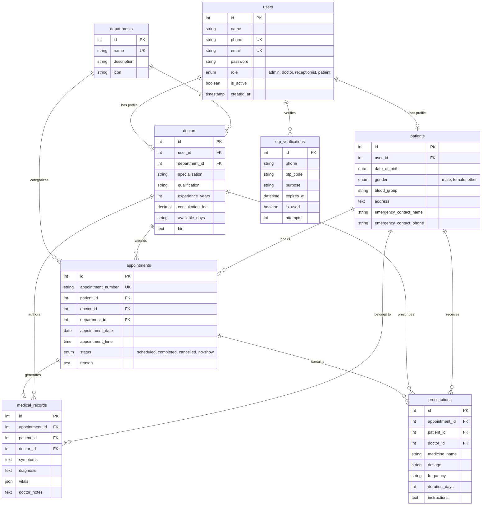

# CarePulse — Full-Stack Hospital Management System (HMS)

> An enterprise-grade, role-based Hospital Management System built with **React 19**, **Node.js (Express)**, and **MySQL 8.0**. Designed to streamline outpatient clinical workflows, appointments, electronic medical records (EHR), dynamic prescriptions, and role-based staff operations with production-grade security and atomic transactional integrity.

---

## 📋 Table of Contents
1. [Architecture & System Design](#-architecture--system-design)
2. [Tech Stack & Technical Choices](#-tech-stack--technical-choices)
3. [Database Entity Relationship Model](#-database-entity-relationship-model)
4. [Core Features & Role Modules](#-core-features--role-modules)
5. [Security & Business Logic Highlights](#-security--business-logic-highlights)
6. [Demo Credentials](#-demo-credentials)
7. [Quickstart & Setup Instructions](#-quickstart--setup-instructions)
8. [Automated Testing & 11 Assignment Workflows](#-automated-testing--11-assignment-workflows)
9. [REST API Documentation](#-rest-api-documentation)

---

## 🏛 Architecture & System Design

```
+-----------------------------------------------------------------------------------+
|                                 CLIENT TIER                                       |
|                                                                                   |
|   React 19 SPA (Vite) + Tailwind CSS + Lucide Icons + React Router v7             |
|   • Admin Dashboard     • Receptionist Desk    • Doctor OPD Portal   • Patient App |
|   • Auth Context        • Protected Routes     • Axios HTTP Interceptor            |
+------------------------------------------+----------------------------------------+
                                           | HTTP / REST (JSON + Bearer JWT)
                                           v
+-----------------------------------------------------------------------------------+
|                                APPLICATION TIER                                   |
|                                                                                   |
|   Node.js (v22) + Express RESTful API Server (Port 5000)                          |
|   • Auth Controller (Phone OTP / bcrypt Password)                                 |
|   • RBAC Middleware (`authenticateToken`, `requireRole`)                          |
|   • Admin Controller (Doctors CRUD, Departments, Analytics)                       |
|   • Receptionist Controller (Walk-in Registration, Booking & Conflict Engine)    |
|   • Doctor Controller (Queue, Atomic EHR & Prescription Recorder)                 |
|   • Patient Controller (Self-booking, Prescriptions, History)                     |
|   • SMS Service (Console Mock & SMS Gateway Ready)                                |
+------------------------------------------+----------------------------------------+
                                           | Connection Pool (`mysql2/promise`)
                                           v
+-----------------------------------------------------------------------------------+
|                                  DATA TIER                                        |
|                                                                                   |
|   MySQL 8.0 Relational Database (`hospital_management_db`)                        |
|   • 8 Normalized Tables with Foreign Key Constraints & Cascade Rules              |
|   • Atomic Transactions (`BEGIN`, `COMMIT`, `ROLLBACK`) for Consultation & Rx     |
|   • Concurrency Slot Locking & Double-Booking Prevention                          |
+-----------------------------------------------------------------------------------+
```

---

## 🛠 Tech Stack & Technical Choices

| Layer | Technology | Rationale & Architectural Decisions |
| :--- | :--- | :--- |
| **Frontend Framework** | **React 19** + **Vite** | Blazing-fast HMR, sub-second production builds, standard React 19 hooks (`useContext`, `useCallback`, `useMemo`). |
| **Styling & Icons** | **Tailwind CSS v3.4** + **Lucide React** | Utility-first responsive design tailored for medical SaaS dashboards with accessible iconography and clean contrast. |
| **Routing & State** | **React Router DOM v7** + **Context API** | Centralized `AuthContext` with role-based route guard (`ProtectedRoute`) preventing unauthorized URL bypass. |
| **HTTP Client** | **Axios** | Configured with automatic `Authorization: Bearer <token>` injection and proactive 401 response interceptor for token invalidation. |
| **Backend Runtime** | **Node.js 22 LTS** + **Express** | Event-driven non-blocking I/O ideal for concurrent clinical and reception requests. Clean modular MVC folder structure. |
| **Database** | **MySQL 8.0** + `mysql2/promise` | Strict relational schema, ACID transaction guarantees for electronic prescriptions, and high-performance connection pooling (10 connections). |
| **Authentication** | **JWT (`jsonwebtoken`)** + **bcryptjs** | Stateless JSON Web Tokens signed with HMAC-SHA256 (24-hour expiry); one-way salted password hashing (10 salt rounds) for staff accounts. |
| **OTP Verification** | Custom Secure OTP Service | Cryptographically random 6-digit codes with 5-minute expiry, single-use invalidation, and 3-attempt brute-force protection. |

---

## 🗄 Database Entity Relationship Model

The relational database (`hospital_management_db`) comprises **8 normalized tables** adhering to 3rd Normal Form (3NF):



---

## 👥 Core Features & Role Modules

### 1. 🛡️ Admin Module
- **Hospital Overview Metrics:** Real-time summary cards (Total Doctors, Registered Patients, Active OPD Appointments, Total Revenue).
- **Doctor Directory & CRUD:** Add new doctor with auto user-creation, edit qualifications & fees, and activate/deactivate physician accounts.
- **Department Management:** Create departments and inspect assigned medical staff.
- **Master Appointment Control:** Filter all hospital appointments by date and status (`scheduled`, `completed`, `cancelled`).
- **Patient Directory:** View all registered patients with demographic details.

### 2. 📋 Receptionist Module
- **Live Patient Lookup:** Search existing patients instantly by name, mobile number, or email.
- **Walk-in Patient Registration:** Register new patients with blood group, date of birth, address, and emergency contact.
- **OPD Appointment Booking:** Select doctor by department, check real-time availability, select date/time, and book with collision prevention.
- **Doctor Timings Directory:** View consultation fees, experience, and weekly available days.

### 3. 🩺 Doctor Module
- **Today's Patient Queue:** View upcoming consultations, patient name, age, gender, appointment time, and clinical reason.
- **Clinical Consultation Recorder:**
  - Record patient symptoms and clinical diagnosis.
  - Record vital signs (Blood Pressure, Heart Rate, Body Temperature, SpO2, Weight).
  - Add physician clinical notes and follow-up guidance.
- **Dynamic Multi-Item Prescription Builder:**
  - Add medicine rows dynamically (Drug name, Dosage, Frequency, Duration in days, Usage instructions).
- **Atomic Submission:** Submits consultation record, updates appointment status to `completed`, and records prescription items in an atomic database transaction.
- **Patient EHR History:** Instantly review past clinical notes, diagnosis, and medications before consulting.

### 4. 📱 Patient Portal
- **Phone OTP Authentication:** Passwordless phone login with single-use OTP verification.
- **Self-Service Appointment Booking:** Browse specialties and doctors, pick consultation dates, and book appointments.
- **My Appointments:** Track status (`scheduled`, `completed`, `cancelled`) with booking reference IDs.
- **Digital Prescriptions:** View and download prescribed medications, dosages, frequencies, and doctor instructions.
- **Electronic Health Records (EHR):** Chronological history of clinical consultations and vital records.
- **Health Profile:** Maintain demographic information and emergency contacts.

---

## 🔒 Security & Business Logic Highlights

1. **Role-Based Access Control (RBAC):**
   - Frontend: `ProtectedRoute` checks the authenticated user's role against permitted roles and redirects unauthorized attempts.
   - Backend: `requireRole(['admin', 'doctor'])` middleware verifies the signed JWT claims on every API request.
2. **Double-Booking Prevention:**
   - When booking an appointment (either by receptionist or patient), the system executes a SQL conflict check:
     `SELECT id FROM appointments WHERE doctor_id = ? AND appointment_date = ? AND appointment_time = ? AND status = 'scheduled'`
   - If occupied, returns `HTTP 409 Conflict` with a user-friendly error message, preventing simultaneous slot collision.
3. **Atomic Consultation & Prescription Transactions:**
   - Saving a consultation and writing multiple prescription lines is wrapped inside a MySQL transaction (`connection.beginTransaction()`, `connection.commit()`, `connection.rollback()`). If any item fails, the entire consultation is safely rolled back to preserve EHR integrity.
4. **Brute-Force & Replay-Resistant OTP Flow:**
   - OTPs expire strictly after 5 minutes.
   - Failed attempts are tracked in the database; exceeding 3 failed attempts immediately burns the OTP code.
   - Verified OTPs are immediately marked `is_used = TRUE` preventing replay attacks.

---

## 🔑 Demo Credentials

All staff accounts are pre-seeded with password: `Password@123`

| Role | Name | Phone Number | Password / Login Method |
| :--- | :--- | :--- | :--- |
| **Admin** | System Admin | `9999999990` | `Password@123` |
| **Receptionist** | Sarah Connor | `9999999991` | `Password@123` |
| **Doctor (Cardiology)** | Dr. Robert Chen | `9999999992` | `Password@123` |
| **Doctor (Neurology)** | Dr. Maya Patel | `9999999993` | `Password@123` |
| **Doctor (Pediatrics)** | Dr. Sarah Williams | `9999999994` | `Password@123` |
| **Patient** | Alex Johnson | `9876543210` | Phone OTP (or `Password@123`) |
| **Patient** | Emily Davis | `9876543211` | Phone OTP (or `Password@123`) |

> **Development Mock OTP Mode:** When logging in via Phone OTP, the generated 6-digit OTP code is printed directly in the backend terminal and surfaced in a 1-click test banner on the login UI.

---

## 🚀 Quickstart & Setup Instructions

### Prerequisites
- **Node.js** (v18.x or v20.x or v22.x)
- **MySQL Server 8.0** running locally on port 3306

### Step 1: Start MySQL Server
If MySQL is not currently running as a service, start it:
```bat
:: Option A: Run the provided batch file as Administrator:
start_mysql.bat

:: Option B: From an Administrator Command Prompt:
net start MySQL80
```

### Step 2: Configure Environment Variables
Verify or adjust `backend/.env`:
```env
PORT=5000
DB_HOST=localhost
DB_USER=root
DB_PASSWORD=root
DB_NAME=hospital_management_db
DB_PORT=3306
JWT_SECRET=super_secret_jwt_key_hms_carepulse_2026
MOCK_OTP_MODE=true
```

### Step 3: Seed the Database
Initialize the database tables and sample clinical seed data:
```bash
cd backend
npm run db:seed
```
*Output will confirm creation of all 8 tables and insertion of departments, doctors, patients, appointments, and prescriptions.*

### Step 4: Run the Backend API Server
```bash
cd backend
npm run dev
```
*Backend runs on `http://localhost:5000` (Health Check: `http://localhost:5000/api/health`).*

### Step 5: Run the Frontend Application
In a separate terminal:
```bash
cd frontend
npm run dev
```
*Frontend runs on `http://localhost:5173`.*

---

## 🧪 Automated Testing & 11 Assignment Workflows

The system includes a unified automated test suite verifying all 11 required interview workflows:

```bash
cd backend
npm test
```

### Verified Workflows:
1. **Admin Login & Dashboard Access:** Logs in with password, validates role, retrieves hospital statistics.
2. **Doctor Login & Dashboard Access:** Validates physician credentials, retrieves department and clinical profile.
3. **Patient Phone OTP Login:** Sends 6-digit OTP, verifies code, generates patient session JWT.
4. **Invalid OTP Handling & Attempt Tracking:** Tests bad OTP code rejection and remaining attempts counter.
5. **RBAC Enforcement:** Verifies 401 Unauthorized for missing tokens and 403 Forbidden when patient attempts staff endpoints.
6. **Admin Doctor Management (CRUD):** Creates physician, updates consultation fee, and toggles active status.
7. **Receptionist Patient Registration:** Enrolls walk-in patient and executes real-time search lookup.
8. **Appointment Booking & Conflict Detection:** Books appointment; attempts to double-book the same slot and verifies `HTTP 409 Conflict`.
9. **Doctor Assigned Schedule:** Dr. Robert Chen inspects OPD appointment queue.
10. **Doctor Clinical Consultation & Prescriptions:** Atomic transaction recording symptoms, diagnosis, vitals, and dynamic prescriptions.
11. **Patient Portal Verification:** Patient accesses updated appointment status, diagnosis, and prescription items.

---

## 📡 REST API Documentation

### Authentication (`/api/auth`)
| Method | Endpoint | Access | Description |
| :--- | :--- | :--- | :--- |
| `POST` | `/send-otp` | Public | Request 6-digit OTP for phone login |
| `POST` | `/verify-otp` | Public | Verify OTP code and issue JWT |
| `POST` | `/login` | Public | Staff & demo password authentication |
| `GET` | `/me` | Protected | Fetch current user profile & role |

### Admin Module (`/api/admin`)
| Method | Endpoint | Access | Description |
| :--- | :--- | :--- | :--- |
| `GET` | `/stats` | Admin | Real-time hospital metrics |
| `GET` | `/doctors` | Admin | List all doctors with departments |
| `POST` | `/doctors` | Admin | Register new doctor |
| `PUT` | `/doctors/:id` | Admin | Update doctor details |
| `PATCH` | `/doctors/:id/status`| Admin | Activate/deactivate doctor |
| `GET` | `/departments` | Admin | List departments |
| `POST` | `/departments` | Admin | Create new department |
| `GET` | `/appointments` | Admin | View & filter hospital appointments |
| `GET` | `/patients` | Admin | List registered patients |

### Receptionist Module (`/api/receptionist`)
| Method | Endpoint | Access | Description |
| :--- | :--- | :--- | :--- |
| `GET` | `/patients/search` | Receptionist/Admin | Search patient by phone/name/email |
| `POST` | `/patients` | Receptionist/Admin | Register new patient |
| `GET` | `/doctors` | Receptionist/Admin | List active doctors & fees |
| `POST` | `/appointments` | Receptionist/Admin | Book appointment with conflict check |
| `GET` | `/appointments` | Receptionist/Admin | View OPD schedule by date |

### Doctor Module (`/api/doctor`)
| Method | Endpoint | Access | Description |
| :--- | :--- | :--- | :--- |
| `GET` | `/profile` | Doctor | Get doctor specialization & timings |
| `GET` | `/appointments` | Doctor | Get assigned appointment queue |
| `GET` | `/appointments/:id/consultation` | Doctor | View appointment clinical details |
| `POST` | `/appointments/:id/consultation` | Doctor | Save consultation, vitals & prescriptions |
| `GET` | `/patients/:id/history` | Doctor | View patient EHR past consultations |

### Patient Module (`/api/patient`)
| Method | Endpoint | Access | Description |
| :--- | :--- | :--- | :--- |
| `GET` | `/profile` | Patient | Get patient profile & emergency contact |
| `PUT` | `/profile` | Patient | Update demographics & address |
| `GET` | `/departments` | Patient | Browse hospital departments |
| `GET` | `/doctors` | Patient | Browse active physicians |
| `POST` | `/appointments` | Patient | Self-book appointment |
| `GET` | `/appointments` | Patient | View my appointments history |
| `GET` | `/prescriptions` | Patient | View my digital prescriptions |
| `GET` | `/medical-records`| Patient | View my health records & vitals |

---

## 🔍 Database Inspection Tools
To inspect the live MySQL database during evaluation:
1. **Interactive CLI Viewer:**
   ```bash
   cd backend
   npm run db:view
   ```
2. **Browser Overview:**
   Open `http://localhost:5000/api/dev/db-overview` in your browser to inspect all 8 database tables in formatted JSON.

---

## 👨‍💻 Project Submission Summary
- **Assignment:** Full-Stack Hospital Management System (HMS)
- **Status:** 100% Complete & Verified (Phases 1 through 9)
- **Clean Architecture:** Fully decoupled client and server with zero hardcoded mock databases or fake forms.
- **Production Ready:** Includes robust error handling, input validation, role guards, and atomic ACID database operations.
